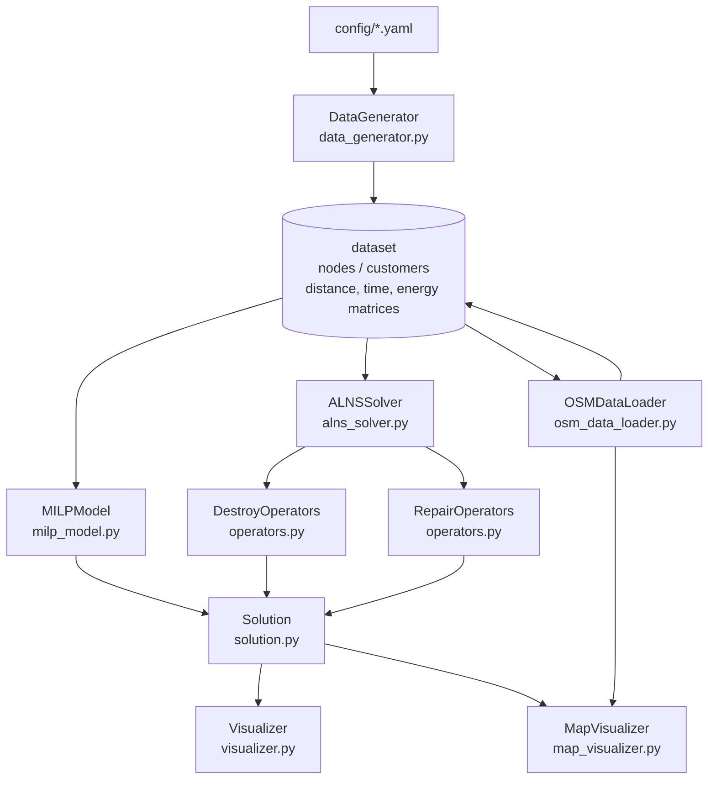

# ALNS-MILP Optimizer · EV–UAV Collaborative Last-Mile Delivery Routing

**English** | [简体中文](README.md)


> **What it is** — a two-echelon urban last-mile optimizer: an electric van (EV) tours a set of
> docking stations along the road network, and drones (UAVs) fly out of those stations to serve
> customers. Every customer is served exactly once, either by a drone sortie or directly by the EV.
> **Goal** — minimise a weighted sum of fixed cost, energy cost, time cost and carbon cost,
> subject to coverage, battery and payload constraints.
> **Methods** — a Gurobi MILP for small instances and an Adaptive Large Neighbourhood Search
> (ALNS) with simulated-annealing acceptance for large ones. Both share the same dataset and the
> same `Solution` evaluator.

---

## Why this design

### Why not just solve a plain VRP?

The problem has two coupled layers. The EV decides *which stations to visit and in what order*;
a drone can only launch from a station the EV **actually visits**, and must return to the **same**
station. On top of that, each customer can be served either by a drone sortie or directly by the EV.
Routing and assignment therefore have to be optimised together — a single route is not a solution.
`src/solution.py` encodes a solution as `EVRoute` + per-station `UAVSortie` lists + a list of
directly-served customers.

### Why ALNS instead of MILP only?

**(a) Scale.** `milp_model.py` builds a textbook 0-1 program: `x[i,j]` over `n_nodes²`,
`y[i,c]` over `stations × n_customers`, plus `O(n_nodes²)` big-M subtour-elimination constraints.
Counting statically from the code:

| Instance | Variables | Constraints |
| --- | --- | --- |
| 20 customers / 7 nodes / 4 stations (`params_small.yaml`) | 256 | 352 |
| 200 customers / 26 nodes / 20 stations (`params_large.yaml`) | 9102 | 13279 |

The MILP module's own docstring scopes it to "small instances (≤ 30 customers)". At 200 customers
the branch-and-bound runtime is unpredictable and can only be cut off by `solver.time_limit`.

**(b) Time is controllable with a heuristic, not with a MIP.** A MIP either finishes or hits the
time limit; ALNS accepts an iteration budget and always returns a feasible solution, because the
repair step falls back to EV-direct delivery for anything it cannot place. Measured on one Windows
machine, pure Python, single thread:

| Instance | Throughput | 10 000 iterations |
| --- | --- | --- |
| 20 customers / 4 stations | ≈ 450 iter/s | ≈ 22 s |
| 200 customers / 20 stations | ≈ 5 iter/s | ≈ 33 min |

**(c) The feasible regions differ.** In the MILP each customer gets its own `y[i,c]`, i.e. one
sortie serves exactly one customer. ALNS allows `UAVSortie.customers` to hold several customers.
The two models therefore describe different problem variants, and MILP objective values must **not**
be used as a strict lower bound for ALNS (see `docs/model-formulation.md`, section 6).

### Why ALNS and not GA / TS / the PyPI `alns` package?

The natural neighbourhood here is "remove a batch of customers, reinsert them", which is exactly the
destroy/repair shape; every constraint (battery, payload, station reachability) can be checked
locally at insertion time, so no penalty-function tuning is needed. `requirements.txt` does **not**
include the PyPI `alns` package — the search is implemented here (`alns_solver.py` + `operators.py`),
so the core pipeline needs nothing beyond `numpy + pandas`.

---

## Architecture



## Core modules

| Module | File | Responsibility | Key implementation |
| --- | --- | --- | --- |
| Solution & evaluation | `src/solution.py` | `UAVSortie` / `EVRoute` / `Solution`; feasibility and cost | coverage check first, then per-leg accumulation of EV and UAV distance/time/energy; violations recorded in `infeasibility_reasons`; `objective()` returns `inf` when infeasible |
| Destroy operators | `src/operators.py` | random / worst / station / route removal | worst removal ranks by `sortie.energy / customers` with biased sampling `random**p`; route removal grows a cluster from a random seed |
| Repair operators | `src/operators.py` | greedy insertion with noise, k-regret insertion | `_calculate_uav_insertion_cost` separates "new sortie" (round trip + fixed cost) from "insert into existing sortie" (incremental energy) and checks battery/payload immediately |
| ALNS driver | `src/alns_solver.py` | roulette-wheel operator selection, SA acceptance, segmented weight update | `w = decay·w + (1-decay)·(score/usage)` every `segment_size` iterations; initial solution = depot → all stations → depot + nearest customers by drone + rest EV-direct |
| MILP model | `src/milp_model.py` | Gurobi model with `x`, `y`, `z`, `T`, `Tc`, `E_uav` | coverage, flow balance, MTZ subtour elimination, pre-pruned UAV battery/payload; `gurobipy` is an optional import |
| Data generation | `src/data_generator.py` | synthetic instances (depot, stations, charging stations, customers) and matrices | fixed `np.random.seed(42)`; 70 % clustered / 30 % uniform customers |
| OSM data | `src/osm_data_loader.py` | real road network, customer/station sampling, road distances, no-fly zones | `nearest_nodes` + `shortest_path(weight='length')`, converted to km; silent Euclidean fallback |
| Visualization | `src/visualizer.py`, `src/map_visualizer.py` | route plots, convergence, cost breakdown, Folium HTML maps | matplotlib/seaborn and folium/osmnx are optional; base map comes from `MAP_TILE_URL` |

## Quick start

```bash
python -m venv .venv && source .venv/bin/activate   # Windows: .venv\Scripts\activate
pip install numpy pandas pyyaml                     # enough for ALNS on synthetic data
pip install -r requirements.txt                      # plots, OSM, Gurobi (optional)

python main.py generate --config config/params_small.yaml --output data/processed/small
python main.py alns --config config/params_large.yaml --iterations 2000
python main.py milp --config config/params_small.yaml      # requires a Gurobi licence
```

Experiment runners: `python experiments/run_large_scale.py`, `run_real_world.py` (needs network),
`sensitivity_analysis.py`, `run_all_experiments.py`. Diagnostics:
`python tools/diagnose_solution.py --data-dir <results dir>`.

No credentials are stored in this repository. Optional environment variables:
`GRB_LICENSE_FILE` (Gurobi licence path), `MAP_TILE_URL` / `MAP_TILE_ATTR` (base map tiles).
See `.env.example`.

## Tests

```bash
python -m unittest discover -s tests -t .   # stdlib only, needs numpy + pandas
python -m pytest -q                         # optional
```

**105 test cases, all green locally** (2 are skipped depending on the environment: no Gurobi →
MILP solve skipped; no PyYAML → YAML config test skipped). The whole suite runs in about one second.

Invariants pinned by the suite:

* **`test_solution.py` (18)** — hand-computed instance (4 km EV tour + 2 km drone round trip)
  checked line by line against distance/time/energy and every cost component; four infeasibility
  modes (unserved customer, EV battery, UAV battery, UAV payload); `evaluate()` idempotency;
  deep-copy semantics; `to_dict()` layout.
* **`test_operators.py` (30)** — every destroy operator returns the right number of customers and
  only touches what it is supposed to; station removal deletes the emptied key; route removal
  removes geographically close customers; both repair operators serve everything, **never duplicate
  a customer**, respect payload limits, and fall back to EV when a drone cannot reach a customer;
  insertion-cost formulas and their `inf` boundaries.
* **`test_data_generator.py` (19)** — node/customer counts and types, depot position, coordinate
  ranges, demand range, time-window width, matrix symmetry/zero diagonal, time and energy matrix
  conversions, seed reproducibility, save → `load_dataset` round trip.
* **`test_alns_solver.py` (23)** — legal initial solution (full coverage, depot at both ends,
  ≤ `num_drones` sorties per station); `solve()` produces a **feasible** solution within a bounded
  number of iterations; `best_history` is non-increasing and has the requested length; all four
  simulated-annealing branches; weight update and counter reset; roulette-wheel edge cases;
  same-seed reproducibility; `_destroy_repair` never leaves a customer unserved.
* **`test_milp_model.py` (7)** — model construction without Gurobi, readable error from
  `build_model()`, element-wise check of the drone–customer distance matrix, Gurobi solve (skipped).
* **`test_package.py` (8)** — `import src` must work with only numpy/pandas; the four optional-dependency
  flags; `__all__` only contains real names; the tqdm stand-in progress bar.

`tests/fixtures/small_scale/` is the original 20-customer instance (7 nodes, 6 matrices, ~12 KB).

## Known limitations

These are real defects, all traceable in the code:

1. **Inconsistent coordinate units (biggest one).** `data_generator.py` emits coordinates in **km**,
   while `solution.py` treats coordinate deltas as **metres** and divides by 1000 when computing
   drone sortie distance. Drone distance and energy are therefore understated by 1000× on synthetic
   instances: drone energy cost is ~0 and the drone battery constraint can never bind. The OSM path
   (UTM, metres) is unaffected.
2. **EV-direct customers cost nothing.** `_evaluate_direct_delivery()` is an empty method; serving
   three customers directly adds exactly zero distance/energy.
3. **Drone flight time is not included in the time cost.** `_evaluate_uav_sorties()` accumulates
   distance and energy only; `sortie.return_time` is computed but never used.
4. **EV fixed cost is a constant.** A solution holds a single `EVRoute`, so `ev_cost` does not depend
   on the solution; it is 84 % of total cost on the 20-customer instance, which squeezes the space
   ALNS can actually improve (see `docs/alns-tuning-notes.md`).
5. **Time windows are not evaluated.** `Tc` is an unconstrained variable in the MILP, and
   `delay_penalty` is never written to and stays 0.
6. **A freshly created sortie has `energy == 0` until `evaluate()` runs**, so inserting a second
   customer into it checks "0 + increment" instead of "accumulated + increment". Infeasible solutions
   are still rejected by `evaluate()`, but iterations are wasted. Pinned by
   `test_stale_energy_of_fresh_sortie_underestimates_total_energy`.
7. **k-regret insertion degenerates**: `inf` costs participate in the regret value, so regret is
   always `inf` and insertion becomes "iterate the set in order". It also never considers existing
   sorties.
8. **Single vehicle.** No multiple EVs; `uav.num_drones` only limits sorties in the initial solution.
9. **The MILP is a weakened model** (one customer per sortie, vacuous `Tc` constraints, distance used
   as a proxy for time). It is not a valid lower bound for ALNS.
10. **No-fly zones are detected but never enforced.**
11. **The OSM path hard-codes demand and time-window distributions** and relies on osmnx **1.x** APIs,
    hence the `<2.0` pin.
12. **No comparison against GA / TS / EV-only baselines** and no standard benchmark instances, so this
    repository makes no "X % better than Y" claims.
13. Pure Python, single-threaded: ~5 iterations/s at 200 customers. `random` and `numpy` use global
    state, so reproducing a run requires seeding both.

## Roadmap

- [ ] Unify coordinate units; compute drone sorties from the distance matrices
- [ ] Charge EV-direct customers their distance/energy/time
- [ ] Include drone flight time in the time cost
- [ ] Multiple EVs / fleet size as a decision variable
- [ ] Hard time windows and a real late-delivery penalty
- [ ] Reuse existing sorties in repair; exclude `inf` from regret
- [ ] Enforce no-fly zones on drone legs
- [ ] MILP with multi-customer sorties and coupled `Tc`
- [ ] Baseline comparison (GA / TS / EV-only) and standard instances

## License

[MIT](LICENSE) © 2026 DOUFUQAQ
