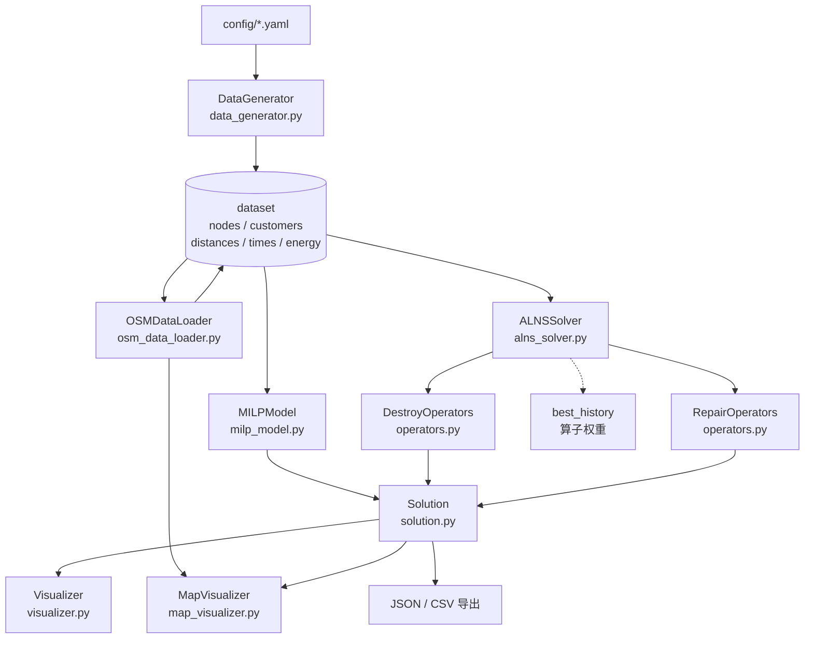

# ALNS-MILP 优化求解器 · 电动车-无人机协同末端配送路径优化

[English](README.en.md) | **简体中文**


> **这是什么**：一个两层（two-echelon）城市末端配送优化器 —— 电动车（EV）沿道路巡游若干停靠站点，
> 无人机（UAV）从站点起飞服务客户，每个客户要么由 UAV 服务、要么由 EV 顺路直送。
> **解决什么问题**：在客户全覆盖、EV/UAV 电池与载重等约束下，最小化
> 「固定成本 + 能耗 + 时间 + 碳排放」的加权总成本。
> **核心做法**：小规模用 **Gurobi** 建 MILP 求精确解，大规模用 **ALNS**（自适应大邻域搜索 +
> 模拟退火接受准则）求可行好解；同一套数据与 `Solution` 评价函数。

---

## 为什么这么做

### 1. 为什么是"两层协同"，而不是经典 VRP

经典 VRP 只有一层（车 → 客户）。这里多了一层，而且两层是**耦合**的：

* EV 决定**访问哪些站点、按什么顺序**；
* UAV 只能从 **EV 实际访问过的站点**起飞，飞完还要飞回**同一个**站点；
* 一个客户既可以由 UAV 服务，也可以由 EV 直送 —— **分配决策**和**路径决策**必须一起做。

所以解不是一条路径，而是「EV 序列 + 每个站点的架次列表 + EV 直送客户列表」。
`src/solution.py` 的 `EVRoute` / `UAVSortie` 就是这个结构。

### 2. 为什么用 ALNS，而不是只用 MILP

这是本仓库最关键的取舍，理由有三条，都能在代码里对上：

**(a) 规模上不去。** `milp_model.py` 建的是最朴素的 0-1 规划：`x[i,j]` 是
`n_nodes × n_nodes` 个二值变量，`y[i,c]` 是 `stations × n_customers` 个，再叠加
MTZ 消子回路带来的 `O(n_nodes²)` 条大 M 约束。按代码结构静态数一下：

| 算例 | 变量数 | 约束数 |
| --- | --- | --- |
| 20 客户 / 7 节点 / 4 站点（`params_small.yaml`） | 256 | 352 |
| 200 客户 / 26 节点 / 20 站点（`params_large.yaml`） | 9102 | 13279 |

`milp_model.py` 自己的注释写的是「用于小规模（≤30 客户）」。200 客户那个规模，
整数规划的求解时间不可控，只能靠 `solver.time_limit` 硬截断。

**(b) 时间不可控 ≠ 时间可接受。** MILP 只能设 `TimeLimit` 然后祈祷；
ALNS 的迭代预算可以精确控制，给定预算就一定能返回一个可行解
（修复算子兜底：实在插不进 UAV 的客户全部转 EV 直送）。
实测（一台 Windows 机器、纯 Python、单线程）：

| 算例 | 迭代速度 | 10000 次迭代耗时 |
| --- | --- | --- |
| 20 客户 / 4 站点 | ≈ 450 迭代/秒 | ≈ 22 s |
| 200 客户 / 20 站点 | ≈ 5 迭代/秒 | ≈ 33 min |

**(c) 解空间不一样。** MILP 里每个客户都是一个独立的 `y[i,c]`，等于**一个架次只服务一个客户**；
而 ALNS 的 `UAVSortie.customers` 是列表，一个架次可以串多个客户。
也就是说两者优化的不是同一个可行域 —— 拿 MILP 的结果当 ALNS 的严格下界是**错的**（详见
[docs/model-formulation.md](docs/model-formulation.md) 第 6 节）。

**结论**：MILP 只用来做小规模的最优性参照与建模校验，规模化求解交给 ALNS。
两者共用 `src/solution.py` 的 `Solution` 与同一份 `dataset`，所以结果可以直接对比。

### 3. 为什么是 ALNS，而不是 GA / TS / 现成的 `alns` 库

* 这个问题的邻域天然是**"把一批客户从解里摘出来，再插回去"** —— 正是 destroy/repair 的形状；
  每一条约束（电池、载重、站点可达）都能在**插入的那一刻局部检查**，不需要罚函数调参。
* 模拟退火接受准则 + 分段自适应权重（Ropke & Pisinger 那一套）几十行就能写完，
  没有种群、没有编码/解码，调试成本低。
* `requirements.txt` 里**没有** PyPI 的 `alns` 包：算法是本仓库自己实现的
  （`alns_solver.py` + `operators.py`），所以没有额外的算法框架依赖，
  核心链路只需要 `numpy + pandas`。

---

## 架构



执行链路一句话：`DataGenerator` 造数据 → `ALNSSolver` 反复「破坏 → 修复 → `Solution.evaluate()` →
模拟退火接受」→ 返回 `Solution` → `Visualizer` 出图或导出。

---

## 核心模块

| 模块 | 文件 | 职责 | 关键实现 |
| --- | --- | --- | --- |
| 解的表示与评价 | `src/solution.py` | `UAVSortie` / `EVRoute` / `Solution`；可行性检查与成本计算 | `evaluate()` 先查客户全覆盖，再逐段累计 EV 与 UAV 的距离/时间/能耗；电池与载重越界写入 `infeasibility_reasons`；`objective()` 不可行返回 `inf` |
| 破坏算子 | `src/operators.py` | 4 个：随机移除、最差移除、站点移除、相邻移除 | `worst_removal` 按 `sortie.energy / 客户数` 排序并用 `random**p` 做偏置采样；`route_removal` 从随机起点贪心地连最近的客户 |
| 修复算子 | `src/operators.py` | 2 个：贪心插入（带噪声）、k-regret 插入 | `_calculate_uav_insertion_cost` 区分「新建架次」（往返距离 + 固定成本）与「插入已有架次」（增量能耗），并即时检查电池/载重 |
| ALNS 主循环 | `src/alns_solver.py` | 轮盘赌选算子、模拟退火接受、分段更新权重、记录收敛历史 | 权重更新 `w = decay·w + (1-decay)·(累计得分/使用次数)`，每 `segment_size` 轮清零；初始解 = `仓库→所有站点→仓库` + 每站点最近客户 UAV + 剩余客户 EV 直送 |
| MILP 精确模型 | `src/milp_model.py` | Gurobi 建模：`x`(EV 路径) / `y`(UAV 分配) / `z`(EV 直送) / `T`, `Tc`(时间) / `E_uav`(能耗) | 客户覆盖、流平衡、MTZ 消子回路、UAV 电池与载重前置剪枝；`gurobipy` 是可选导入 |
| 数据生成 | `src/data_generator.py` | 合成算例：仓库 + 站点 + 充电站 + 客户，距离/时间/能耗矩阵 | 固定 `np.random.seed(42)`；客户 70% 聚集 / 30% 均匀；矩阵按 `speed`、`energy_consumption` 换算 |
| OSM 数据 | `src/osm_data_loader.py` | 从 OpenStreetMap 取真实路网、采样客户与站点、算路网距离、识别禁飞区 | `nearest_nodes` + `shortest_path(weight='length')`，结果换算成 km；失败静默回退欧氏距离 |
| 可视化 | `src/visualizer.py` | 路径图、收敛曲线、成本分解、结果导出 | matplotlib + seaborn；中文字体探测；缺依赖时整个模块降级 |
| 地图可视化 | `src/map_visualizer.py` | Folium 交互式 HTML：路网 + EV 沿路 + UAV 直线 | 底图由 `MAP_TILE_URL` 环境变量决定，默认 OpenStreetMap |

---

## 快速开始

```bash
git clone <this-repo> && cd alns-milp-optimizer
python -m venv .venv
source .venv/bin/activate          # Windows: .venv\Scripts\activate

# 只跑 ALNS + 合成算例，这就够了：
pip install numpy pandas pyyaml
# 要出图 / 跑实验脚本：
pip install -r requirements.txt
```

### 1. 生成数据集

```bash
python main.py generate --config config/params_small.yaml --output data/processed/small
# 产物：nodes.csv / customers.csv / 6 个矩阵 .npy / config.json
```

### 2. ALNS 求解

```bash
# 直接内存生成数据（不落盘）
python main.py alns --config config/params_large.yaml --iterations 2000

# 或者用已生成的数据集
python main.py alns --config config/params_large.yaml \
                    --data data/processed/small --iterations 2000 \
                    --output data/results/alns
```

### 3. MILP 精确求解（需要 Gurobi）

```bash
pip install gurobipy
grbgetkey <your-key>          # 学术许可免费，见 https://www.gurobi.com/downloads/
python main.py milp --config config/params_small.yaml
```

没有 Gurobi 时会打印一条安装提示并退出，不会抛一屏 traceback。

### 4. 实验脚本

```bash
python experiments/run_small_scale.py        # 小规模：MILP（需 Gurobi）
python experiments/run_large_scale.py        # 大规模：ALNS
python experiments/sensitivity_analysis.py   # 参数敏感性
python experiments/run_real_world.py         # 真实路网：OSM + Folium（需联网）
python experiments/run_all_experiments.py    # 串起来跑
```

### 5. 排障工具

```bash
python tools/compare_configs.py --base config/params_small.yaml --other config/params_large.yaml
python tools/diagnose_solution.py --data-dir data/results/real_world
```

### 环境变量

仓库里**不含任何密钥**，也不需要 API key。只有两个可选变量：

| 变量 | 用途 | 默认 |
| --- | --- | --- |
| `GRB_LICENSE_FILE` | Gurobi license 文件路径（仅 MILP 需要） | 用 `grbgetkey` 激活的默认位置 |
| `MAP_TILE_URL` / `MAP_TILE_ATTR` | 覆盖 Folium 底图瓦片服务 | Folium 自带的 OpenStreetMap |

参见 [.env.example](.env.example)。

---

## 项目结构

```
alns-milp-optimizer/
├── README.md / README.en.md
├── LICENSE                         # MIT
├── .gitignore / .env.example
├── requirements.txt                # 真实 import 的依赖，按用途分组
├── requirements-dev.txt            # pytest / ruff
├── conftest.py                     # 把仓库根加入 sys.path
├── main.py                         # CLI：generate / alns / milp / experiment
├── config/
│   ├── params_small.yaml           # 20 客户，4 站点
│   ├── params_large.yaml           # 200 客户，20 站点
│   └── params_real_world.yaml      # 50 客户，5 站点（配 OSM 用）
├── src/
│   ├── __init__.py                 # 可选依赖降级在这里
│   ├── solution.py
│   ├── operators.py
│   ├── alns_solver.py
│   ├── milp_model.py
│   ├── data_generator.py
│   ├── osm_data_loader.py
│   ├── visualizer.py
│   └── map_visualizer.py
├── experiments/
│   ├── run_small_scale.py
│   ├── run_large_scale.py
│   ├── run_real_world.py
│   ├── sensitivity_analysis.py
│   └── run_all_experiments.py
├── tools/
│   ├── compare_configs.py          # 两份 YAML 配置差异对比
│   └── diagnose_solution.py        # 解的健康度诊断
├── docs/
│   ├── model-formulation.md        # 数据/解/目标/约束/MILP 建模
│   ├── alns-tuning-notes.md        # 调参与踩坑记录
│   └── osm-road-network.md         # 真实路网链路
├── tests/
│   ├── __init__.py
│   ├── helpers.py                  # 手工小算例 + 解结构不变量检查
│   ├── fixtures/small_scale/       # 20 客户小算例（~12 KB）
│   ├── test_solution.py
│   ├── test_operators.py
│   ├── test_data_generator.py
│   ├── test_alns_solver.py
│   ├── test_milp_model.py
│   └── test_package.py
└── .github/workflows/ci.yml
```

---

## 测试

```bash
# 零额外依赖（只需要 numpy + pandas）
python -m unittest discover -s tests -t .

# 或者装了 pytest 之后
python -m pytest -q
```

**105 个用例，本地实测全绿**（其中 2 个按环境自动跳过：缺 Gurobi → 跳过 MILP 求解；
缺 PyYAML → 跳过 YAML 配置读取）。完整跑完约 1 秒。

覆盖的算法不变量：

| 测试文件 | 用例数 | 覆盖内容 |
| --- | --- | --- |
| `test_solution.py` | 18 | 手算小算例（4 km EV 路径 + 2 km UAV 往返）逐项核对距离/时间/能耗/各分项成本与总成本；4 类不可行（客户未全覆盖、EV 电池、UAV 电池、UAV 载重）；`evaluate()` 幂等；`copy()` 深拷贝；`to_dict()` 结构 |
| `test_operators.py` | 30 | 4 个破坏算子：返回集合大小、只动该动的客户、清空站点后删 key、相邻移除的几何性；2 个修复算子：客户全覆盖、**无重复配送**、载重不越界、UAV 不可行时回退 EV；插入成本公式（新建=往返+固定成本，增量=纯能耗）与 `inf` 边界 |
| `test_data_generator.py` | 19 | 节点/客户数量与类型、仓库存放位置、坐标在区域内、需求区间、时间窗宽度、矩阵对称/零对角/与坐标一致、时间与能耗矩阵的换算、同种子可复现、存盘→`load_dataset` 往返一致 |
| `test_alns_solver.py` | 23 | 初始解结构合法（覆盖全客户、EV 路径首尾为仓库、每站点架次 ≤ `num_drones`）；`solve()` 在有限迭代内给出**可行解**；`best_history` 单调不增且长度等于迭代数；模拟退火四种接受分支；权重更新与计数清零；轮盘赌边界；同种子可复现；`_destroy_repair` 永不留下未服务客户 |
| `test_milp_model.py` | 7 | 无 Gurobi 时构造模型不报错、`build_model()` 给出可读错误；UAV-客户距离矩阵逐元素核对（纯 numpy 部分）；有 Gurobi 时跑通小算例（自动跳过） |
| `test_package.py` | 8 | 只有 numpy/pandas 时 `import src` 必须成功；4 个可选依赖的降级标志；`__all__` 只含真实名字；缺 `tqdm` 时进度条替身可用 |

`tests/fixtures/small_scale/` 是原工程的 20 客户算例（7 节点 / 20 客户 / 6 个 7×7 矩阵，
合计约 12 KB），用来让测试跑在**真实数据**而不是临时编的数据上。

---

## 已知局限

这一节是**真实缺陷清单**，不是免责声明。每条都能在代码里定位。

1. **坐标单位不一致（影响最大的一条）**。`data_generator.py` 生成的坐标单位是 **km**，
   而 `solution.py` 计算 UAV 架次距离时把坐标差当作 **米**、再除以 1000：
   `total_distance_km = dist_meters / 1000`。于是合成算例里 UAV 的距离与能耗被**缩小 1000 倍**，
   UAV 侧能耗成本几乎为 0、电池约束实际上**不可能触发**，UAV 与 EV 的相对成本是失真的。
   OSM 链路（UTM 投影，单位本来就是米）不受影响 —— 这也是 `docs/` 里两份实验记录
   表现不一致的原因之一。
2. **EV 直送客户的成本为 0**。`Solution._evaluate_direct_delivery()` 是空函数
   （注释说"成本已包含在 EV 路径评估中"，实际并没有）。同一条 EV 路径上，
   直送 1 个客户还是 3 个客户，总距离都是 4 km —— 直送没有产生任何额外成本。
3. **UAV 飞行时间没有计入时间成本**。`_evaluate_uav_sorties()` 只累加了 `sortie.distance`
   与 `sortie.energy`，`total_time` 只有 EV 行驶时间；`sortie.return_time` 算出来了但没人用。
4. **EV 固定成本是常数**。当前解结构只有一条 `EVRoute`，`ev_cost = config.ev.fixed_cost`
   与解无关。在 20 客户算例上它占总成本 **84%**（`tools/diagnose_solution.py` 会直接报出来），
   大算例下这个比例会压低 ALNS 的有效优化空间。详见
   [docs/alns-tuning-notes.md](docs/alns-tuning-notes.md)。
5. **时间窗完全没参与评估**。客户的 `time_window_start/end` 只在 MILP 里约束了 `Tc`，
   而 `Tc` 与 `T`、`x`、`y` 没有任何耦合，是空约束；`delay_penalty` 没有任何写入点，恒为 0。
6. **新建架次的 `energy` 字段在 `evaluate()` 之前一直是 0**，所以往刚建好的架次里
   插入第二个客户时，电池检查用的是「0 + 增量」而不是「真实累计 + 增量」，
   可能生成超电池的解（靠 `evaluate()` 打分淘汰，不会静默通过，但浪费迭代）。
   `tests/test_operators.py::test_stale_energy_of_fresh_sortie_underestimates_total_energy`
   把这个行为固定住了。
7. **k-regret 插入会退化**。UAV 选项不可行时成本是 `inf`，而 `inf` 也参与 regret 计算，
   导致 regret 恒为 `inf`，实际退化成"按集合顺序逐个插入"；而且它只考虑**新建**架次，
   不尝试插入已有架次。
8. **单辆车**。不支持多 EV 并行，`uav.num_drones` 只在初始解里限制每站点架次数，
   评估阶段不检查。
9. **MILP 是弱化模型**：一架次只服务一个客户、`Tc` 空约束、时间成本用总距离代理，
   与 `Solution` 的评价口径不同，**不能**当 ALNS 的严格下界。
10. **禁飞区只识别不入模**。`identify_no_fly_zones()` 返回的多边形没有被任何优化代码读取。
11. **OSM 链路的需求/时间窗是写死的**（`demand ~ U(1,5)`、服务时刻 `U(0,240)`），
    不读 `config`；且依赖 osmnx **1.x** 的 API（`geometries_from_place`、
    `graph_from_bbox(north=..., south=...)`），`requirements.txt` 因此锁了 `<2.0`。
12. **没有与 GA / TS / 纯 EV 的对照实验**，也没有标准数据集（Solomon 之类）上的评测，
    所以本仓库**不宣称**任何"比 XX 好 YY%"的结论。
13. 纯 Python 单线程，200 客户约 5 迭代/秒；`Random` 与 `numpy` 用全局随机状态，
    要复现必须同时 `random.seed()` + `np.random.seed()`。

---

## Roadmap

- [ ] 统一坐标单位：合成算例直接用距离矩阵算 UAV 架次，或把生成器改成米
- [ ] EV 直送客户计入距离/能耗/时间
- [ ] UAV 飞行时间计入时间成本
- [ ] 多车辆 EV：让 EV 数量成为决策变量，打破固定成本常数
- [ ] 时间窗硬约束 + 迟到惩罚接入 `delay_penalty`
- [ ] 修复算子复用已有架次；regret 计算排除 `inf`
- [ ] 禁飞区进入 UAV 航段可行性判断
- [ ] MILP 支持多客户架次，`Tc` 与 `x`/`y` 真正耦合
- [ ] 与 GA / TS / 纯 EV 基线的对照实验
- [ ] 标准算例集上的评测脚本

---

## License

[MIT](LICENSE) © 2026 DOUFUQAQ
